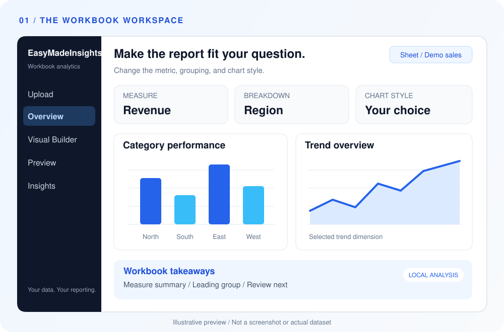
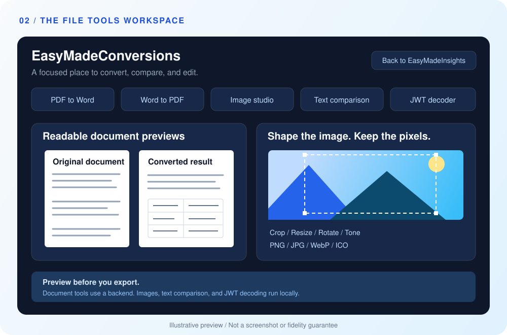

# EasyMadeInsights


**Your workbook, a clearer story. Your files, less friction.**

A browser-first spreadsheet dashboard paired with **EasyMadeConversions**:
two focused workspaces for exploring data and getting everyday file tasks done.

[](https://github.com/0Divyanshu0/EasyMadeInsights/actions/workflows/prod.yml)


[Open the frontend](https://easymadeinsights.web.app) /
[Try the demo workbook](public/easy-made-insights-demo.xlsx) /
[Quick start](#quick-start) /
[Documentation](#documentation)

> **No AI key required.** Workbook analytics, image editing, text comparison,
> and JWT decoding run in your browser. PDF/Word conversion needs a separately
> running backend; Firebase Hosting serves the frontend only.

## Product Tour

| Explore your workbook | Simplify your files |
| --- | --- |
|  |  |
| **EasyMadeInsights** turns tabular data into configurable KPIs, charts, searchable sheet previews, and local workbook takeaways. | **EasyMadeConversions** brings PDF/Word conversion, a photo studio, text comparison, and JWT inspection into one focused workspace. |

*These graphics are illustrative placeholders, not application screenshots or
a promise of exact document-conversion fidelity.*

### Built Around Your Workflow

| Start with a file | Ask a better question | Check the detail |
| --- | --- | --- |
| Upload Excel, CSV, TSV, or JSON and choose a worksheet. | Switch metrics, grouping, trend dimensions, and chart styles. | Expand the preview, search cleaned rows, and read selected-metric takeaways. |

**The small details matter:** light/dark themes, independent workspaces,
confirmation before switching, keyboard-aware preview modals, and image
previews that use the actual encoded export.

<details>
<summary><strong>Explore the complete feature set</strong></summary>

| Capability | Available today | Processing |
| --- | --- | --- |
| Workbook upload | Excel, CSV, TSV, and JSON; worksheet selection | Browser |
| Reporting controls | Metric, breakdown, trend, comparison, and chart styles | Browser |
| Visualizations | Bar, line, area, column, and donut views | Browser |
| Workbook takeaways | Full cleaned-row totals, averages, ranges, leading groups, and review prompts; not AI-generated | Browser |
| Expanded worksheet preview | All columns, search, wrapping cells, and pagination | Browser |
| Document previews | Inline/expanded PDF and DOCX; fit/full-size DOCX pages independent of the app theme | Browser |
| PDF to editable Word | Native text/tables and English scan OCR; requires Python and OCR data for scans | Server |
| Word to PDF | DOCX text/table fallback; Office/LibreOffice for better layout fidelity and legacy DOC | Server |
| Image Converter Studio | Drag/drop, visual crop, resize, rotate, flips, tone controls, undo/redo, PNG/JPG/WebP/ICO | Browser |
| Text/file comparison | Bounded diffs for supported text formats | Browser |
| JWT decoder | Header/payload inspection; does not verify signatures | Browser |

**Not shipped:** accounts, cloud workbook storage, saved report presets, and
report export. An experimental AI endpoint exists in the backend but is not
connected to the dashboard. No AI summary is advertised as an available feature.

</details>

## Quick Start

Run these commands from the **`client` directory**, which is also the Git
repository root. Use Node.js 24, the version configured in CI.

```powershell
npm.cmd ci
npm.cmd run dev
```

| Workspace | Local address |
| --- | --- |
| EasyMadeInsights | `http://localhost:5173/` |
| EasyMadeConversions | `http://localhost:5173/conversions` |
| Express API | `http://localhost:8787` |

On macOS/Linux, use `npm` instead of `npm.cmd`. The development command starts
the UI and API together. The dashboard and browser tools do not require Python.

<details>
<summary><strong>Enable PDF/Word conversion and English OCR</strong></summary>

Python 3.12 is the verified version for the pinned conversion dependencies.
On Windows, run:

```powershell
python -m venv .venv
.\.venv\Scripts\python.exe -m pip install -r python\requirements.txt
.\.venv\Scripts\python.exe python\setup_ocr.py
```

The API finds this local environment automatically; activation is not required.
OCR setup installs a checksum-verified English Tesseract model into ignored
`.ocr/tessdata/`. Provision it on each backend; OCR does not use a paid AI
provider or external document service.

Office/LibreOffice improves Word-to-PDF fidelity. Without it, the Python
fallback renders DOCX text and tables with wrapping and pagination; legacy
binary DOC still needs an office engine.

See [Development](docs/DEVELOPMENT.md) for Linux/macOS instructions and
[Deployment](docs/DEPLOYMENT.md) before exposing the API publicly.

</details>

### Try It With Sample Data

Use the bundled [demo workbook](public/easy-made-insights-demo.xlsx) to explore
the dashboard. It is also served as `/easy-made-insights-demo.xlsx`.
The [demo PDF](public/easy-made-insights-demo.pdf) is for document conversion,
not the spreadsheet uploader.

## Documentation

| Using and understanding the app | Building and shipping it |
| --- | --- |
| **[User Guide](docs/USER_GUIDE.md)**<br />Dashboard controls, all five tools, limits, and interpreting results. | **[Development](docs/DEVELOPMENT.md)**<br />Setup, configuration, tests, troubleshooting, and contributions. |
| **[Architecture](docs/ARCHITECTURE.md)**<br />Components, data flow, state, and runtime boundaries. | **[Deployment](docs/DEPLOYMENT.md)**<br />Firebase Hosting, the separate backend, and production safeguards. |
| **[API Reference](docs/API.md)**<br />Health, document conversion, experimental AI, and error contracts. | **[Production Pipeline](docs/CI_CD.md)**<br />The `prod` branch, quality gates, credentials, and automated releases. |

## Release Flow


Pull requests into `prod` run checks without deploying. Successful pushes to
`prod` can publish the tested frontend artifact to Firebase's live channel.
GitHub's `prod` environment needs deployment credentials and any configured
approval. The API/Python backend is **not** part of this Hosting deployment.

[See the release setup and branch-protection checklist](docs/CI_CD.md).

<details>
<summary><strong>Technology and useful commands</strong></summary>

| Layer | Technologies |
| --- | --- |
| Interface | React 18, React Router 7, custom CSS, browser APIs |
| Analytics | SheetJS `xlsx`, workbook cleaning/aggregation, Recharts 3 |
| API | Node.js ES modules, Express 5, Multer, CORS, dotenv |
| Documents | PyMuPDF/Tesseract OCR, pdfplumber, python-docx, docx2pdf, ReportLab; optional LibreOffice |
| Previews | `docx-preview` and the browser's native PDF viewer |
| Development | Vite 7, concurrently, ESLint, Playwright, Python unittest |
| Hosting | Firebase Hosting; no Firebase database/authentication SDK |
| Experimental AI | OpenAI SDK; backend endpoint only, no dashboard integration |

[package.json](package.json), [package-lock.json](package-lock.json), and
[python/requirements.txt](python/requirements.txt) are the dependency sources
of truth. React 19 type packages do not change the React 18 runtime. Some
document packages generate test fixtures or remain from earlier implementation
paths; see the architecture guide.

| Command, from `client` | Purpose |
| --- | --- |
| `npm.cmd run dev` | Start frontend and API |
| `npm.cmd run dev:ui` / `npm.cmd run dev:api` | Start either service independently |
| `npm.cmd run lint` | Lint configured JavaScript/JSX |
| `npm.cmd run check:syntax` | Check backend/config/test/helper module syntax |
| `npm.cmd run check:docs` | Validate documentation links, examples, and commands |
| `npm.cmd run build` | Generate the frontend in `dist/` |
| `npm.cmd run preview` | Preview the build; does not start/proxy the API |
| `npm.cmd run test:tools` | Run browser regressions and real document conversions |
| `npm.cmd run test:smoke` | Test the built dashboard, routes, and assets |

The parent workspace's package forwards `dev`, `lint`, `build`, and `preview`.
Install dependencies in `client`; from the parent, run browser tests with
`npm.cmd --prefix client run test:tools`.

</details>

<details>
<summary><strong>Data privacy, interpretation, and production boundaries</strong></summary>

Workbooks, images, text comparison, and JWT decoding stay in the browser in
their current flows. Document conversion uploads the selected document to
Express for temporary server-side processing. Workbook data is not
automatically sent to the experimental AI endpoint.

Cleaning removes duplicate rows and fills missing values. Results describe
the **cleaned dataset**, not a lossless audit. Charts use bounded subsets,
currency-like names use USD formatting, and type detection is heuristic.
Reconcile important totals with the source workbook.

Sessions are not saved: refresh, tab closure, reset, or a confirmed workspace
switch clears the current data. Internal workspace switching, including browser
Back/Forward, asks for confirmation; cancel retains the session. Browsers
control the separate leave-page warning's display and wording.

[firebase.json](firebase.json) serves `dist/` with an SPA fallback. It does not
deploy Express, Python, or an API proxy. Document tools need a separately
provisioned backend and a build-time `VITE_API_BASE_URL` or an API rewrite
before the SPA fallback.

The API currently lacks authentication, rate limiting, a concurrency queue,
and production-grade process isolation. Health checks do not verify conversion
engines. See [Deployment](docs/DEPLOYMENT.md) for safeguards.

Automated tests cover browser tools, real PDF/DOCX conversion, and built-site
smoke checks. Analytics depth, accessibility, and hosted production behavior
still need additional coverage. This checkout has no Docker deployment,
Firebase Functions implementation, or license file.

</details>
