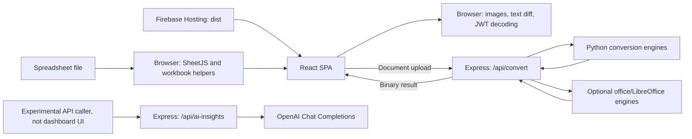
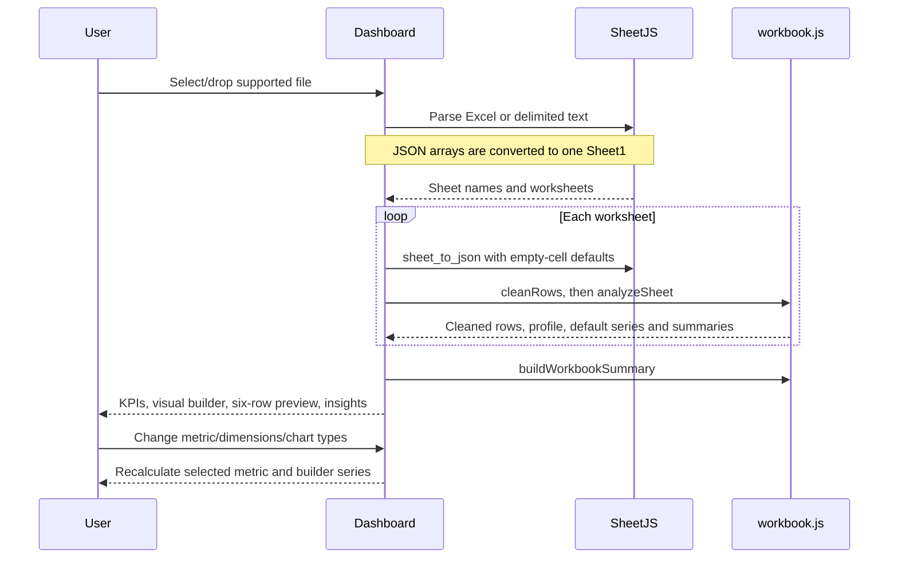

# Architecture

[Documentation Home](../README.md)

## Runtime Boundaries

EasyMadeInsights has a React SPA, a separate Express API, and a Python
conversion worker. Firebase Hosting serves the SPA assets only.

There is no database, account system, cloud workbook storage, or shared
application state store. The dashboard has no active AI request flow.

## Source Map

Paths below are relative to `client`.

| Location | Responsibility |
| --- | --- |
| `src/main.jsx` | Mount the React application |
| `src/App.jsx` | Data router, workspace navigation blocker, app shell, theme, welcome state, route metadata |
| `src/pages/Dashboard.jsx` | Upload orchestration, workbook/session state, visual builder, charts, sections |
| `src/utils/workbook.js` | Cleaning, type heuristics, sheet profiles, default summaries and narratives |
| `src/components/FileUpload.jsx`, `SheetSelector.jsx` | File selection/drop and sheet switching |
| `src/components/KPI.jsx`, `ChartCard.jsx` | Reusable dashboard presentation |
| `src/components/WorkbookTakeaways.jsx` | Selected-metric full-row totals, grouped leaders, conditional concentration review prompts; no network requests |
| `src/components/Dialog.jsx` | Portal-based stacked dialogs, top-layer focus/Escape handling, background inertness, scroll lock and focus restoration |
| `src/components/PreviewModal.jsx`, `SheetPreview.jsx` | Expanded encoded image/document views and searchable, paginated full-sheet table |
| `src/pages/EasyMadeConversions.jsx` | Tool catalogue, search/category filtering, selected modal |
| `src/components/ToolModal.jsx` | Tool dispatch, format aliases, dialog lifecycle and metadata |
| `src/components/tools/DocumentConverter.jsx` | Shared PDF/Word input, preview, request, download, and cancellation state |
| `src/components/tools/PDFToWord.jsx`, `WordToPDF.jsx` | Mode-specific wrappers |
| `src/components/tools/DocxPreview.jsx` | Rich DOCX preview with native page dimensions, resize-observed proportional fit, and stale-render protection |
| `src/utils/conversion.js` | Multipart requests, timeout, binary validation, object-URL download |
| `src/components/tools/ImageConverter.jsx`, `src/utils/imageConversion.js` | Image controls and canvas/ICO encoding |
| `src/components/tools/FileComparison.jsx` | Text upload, bounded line/token diff, and rendering |
| `src/components/tools/JWTDecoder.jsx`, `src/utils/jwt.js` | JWT UI and Base64URL/UTF-8/JSON decoding |
| `src/components/Sidebar.jsx`, `Navbar.jsx`, `WelcomeOverlay.jsx` | Navigation, theme button, branded entry overlays |
| `src/pages/NotFound.jsx` | Unmatched client route |
| `src/index.css`, `src/styles/` | Theme tokens, layout, and component styles |
| `server.mjs` | Express endpoints, uploads, Python selection, office fallback, temporary-file cleanup |
| `python/convert_tool.py`, `python/requirements.txt` | Document conversion logic and pinned Python packages |
| `python/setup_ocr.py`, `python/tests/` | Verified OCR model setup and editability tests |
| `src/styles/image-studio.css` | Responsive photo controls, crop overlay, and untinted export preview |
| `tests/browser/`, `playwright.config.mjs` | Tool interaction, workspace guards, expanded previews, local takeaways, and real-conversion regression tests |
| `tests/smoke/production.spec.mjs`, `playwright.smoke.config.mjs` | Tests against built frontend assets |
| `scripts/check-syntax.mjs`, `scripts/check-docs.mjs` | CI/local syntax and documentation quality checks |
| `.github/workflows/prod.yml` | Sequential quality, regression, build, artifact smoke, and prod Hosting deployment |
| `public/`, `index.html` | Logos, demo files, crawler files, initial HTML metadata |
| `vite.config.js`, `eslint.config.js` | Development proxy, build integration, lint configuration |
| `firebase.json`, `.firebaserc` | Static Hosting configuration and default Firebase project |
| `test-server.js`, `test-diagnostic.mjs` | Empty legacy stubs; not the maintained test suite |

Imports use relative paths. This is JavaScript/JSX, not a TypeScript app.
Exact package versions belong in the manifests/lockfile, not duplicated here.

## Routes and Session State

| Route | Behavior |
| --- | --- |
| `/` | Dashboard sections: Upload, Overview, Visual Builder, Preview, Insights |
| `/conversions` | EasyMadeConversions catalogue; tools open in a modal |
| Any other path | Client NotFound page |

`AppShell` owns theme, welcome visibility, and active section state. Theme is
stored under `easy-made-insights-theme` in local storage and applied through
`document.documentElement.dataset.theme`. The initial theme uses the stored
choice or system preference. The welcome overlay auto-dismisses after 2.6 seconds
and can also be dismissed manually; it is not a network-loading indicator.

`Dashboard` owns the file, parsed sheets, active sheet, selections, chart
styles, loading indicator, and status messages. Switching sheets keeps valid
column selections and chooses defaults for incompatible ones. Switching
routes unmounts Dashboard and discards its workbook state.

Section navigation uses `scrollIntoView`; an `IntersectionObserver` updates
the active sidebar section. These section links are not independent routes.
The tools sidebar hides all dashboard sections and offers only **Back to
EasyMadeInsights**. Mobile users have a workspace switch in the navbar.
Both workspaces are SPA routes, not separate hosted subdomains.

A `createBrowserRouter` data router allows `useBlocker` to intercept transitions
across the Conversions route boundary, including browser Back/Forward. A
confirmation dialog explains session loss; cancel keeps the current route and
state, confirm proceeds and unmounts the previous workspace. This does not
intercept cross-origin navigation or hard reloads. Dashboard retains its
separate browser `beforeunload` warning when a workbook is loaded.

## Workbook Pipeline

Cleaning mutates parsed row objects and then filters duplicates. Source files
are never rewritten. Detection samples populated values in every row and can
classify a column in more than one type group. Numeric parsing runs before date
parsing, but validates the entire value rather than extracting digits from
arbitrary labels or dates. Digit-only identifiers still need manual review.
Default Overview spotlights use the primary measure; selected-builder charts
and Workbook takeaways follow the user's reporting controls.

There are **two reporting paths**: `analyzeSheet` creates default summaries,
spotlights, and narrative insights; Dashboard builds series for the selected
metric/dimensions. Changing builder selections does not rebuild all default
insight cards. Preserve this distinction when extending analytics. Both paths
cap chart points, but share calculations are not identical; the user guide
explains the visible-subset behavior.

`buildAiInsightPayload` remains available but is not consumed by Dashboard.
It includes preview rows as well as aggregate summaries; any future integration
needs a deliberate privacy review rather than an assumption that only aggregates
leave the browser.

## Tool Lifecycle

The catalogue filters tool names/descriptions and category. Opening a tool
mounts a fresh keyed modal. Closing it unmounts the tool and clears its state.
`ToolModal` locks background scrolling, traps Tab focus, supports Escape,
restores opener focus, and restores temporary page metadata.

Browser-only tools use file reads, Canvas, TextDecoder, and clipboard/object-URL
APIs. Image settings generate a debounced preview automatically. Input changes
invalidate stale outputs; comparison still requires an explicit Compare Now.

Document converters share one workflow:

1. Validate extension, nonempty input, and size; clear the previous result.
2. Preview PDF natively or render DOCX; legacy DOC has no browser preview.
3. Send a multipart request through `requestConversion`.
4. Validate success MIME type and PDF/DOCX magic bytes.
5. Expose a separate Download button only for the validated blob.

Input replacement or unmount aborts the client request. DOCX rendering uses a
detached container to prevent late previews overwriting a newer selection.
DOCX pages keep their original widths; frames scale whole pages uniformly
rather than shrinking tables or changing line wrapping. ResizeObserver adapts
fit mode to the available width. Expanded previews support fit and full-size
scrolling; PDF uses the native browser viewer. Document rendering remains
approximate and is not a replacement for inspecting downloaded files.

Scaling frames change the renderer's DOM hierarchy, so its default direct-child
white-paper selector no longer applies. Application CSS explicitly supplies a
white DOCX page background without overriding an inline document background or
individual text colors. Document surfaces use a light color scheme independent
of the app theme. Loading/error notices and busy state prevent silent blank
previews. The expanded body can scroll and its content stage has a 200px minimum
height so short viewports do not collapse the preview.

Dialog portals share a stack: only the top layer traps focus or handles Escape,
lower layers and the app root are inert, and body scroll is restored only after
the final dialog closes. Closing a nested preview returns focus to its tool.

Object URLs are released when replaced or no longer needed. Client cancellation
does not guarantee the server's child process stops.

ImageConverter owns bounded undo history, pointer-capture/keyboard crop
controls, and separate crop/export views. Canvas applies geometry and explicit
pixel adjustments, composites the background, and encodes once. Export preview
uses that encoded blob (the PNG payload for ICO). CSS filters and crop overlays
never change downloaded pixels.

## Document Conversion Pipeline

Express writes a Multer upload to the OS temporary directory, validates the
filename extension, renames it to include that extension, and starts the worker.
Python lookup order is `PYTHON_BIN`, local `.venv`, `python`, `python3`,
then `py`. Missing commands/modules can trigger the next candidate. A genuine
conversion failure can reach the Word-to-PDF route's office fallback.

PDF-to-DOCX is editable-first: PyMuPDF extracts native spans, pdfplumber
detects native tables, and python-docx builds paragraphs/runs/cells. Textless
pages and large scans with sparse text use integrated Tesseract OCR. Force
mode OCRs all pages to recover partial text layers. Full-page scan backgrounds
are omitted; smaller native-page illustrations can remain. Empty/image-only
results fail, without an office-export fallback. Limits are 100 pages and
16 megapixels per OCR render within the existing process/request timeouts.

`setup_ocr.py` installs a pinned/checksummed official English model into
ignored `.ocr/tessdata/`; existing configured/system English data is supported.
Setup is a provisioning step: conversion does not download models or upload
documents to an external OCR provider. OCR table text is editable but not
reconstructed as native table cells.

Word-to-PDF tries docx2pdf with an installed office application, LibreOffice,
then python-docx and ReportLab for simplified paragraphs/tables. The simplified
path cannot parse legacy binary DOC. The Express route also attempts bare
`soffice` after Python fails; this is a best-effort fallback, not guaranteed
support for every format pair.

The text/table fallback accepts DOCX files without a default paragraph style
or style name, using BodyText instead of assuming that a Normal style exists.
Fallback exceptions retain their original diagnostic and exception cause.
Python regression tests disable both Office engines to verify this path on
every platform, independently of installed desktop conversion software.

On success the API reads the result into memory, attempts input/output deletion,
and returns a binary attachment. On caught failures it attempts cleanup and
returns JSON. Cleanup is best effort, not a guaranteed retention policy.

## Package Roles and Constraints

React/Recharts/SheetJS implement the dashboard; Express/Multer implement
uploads; dotenv loads server configuration. `docx-preview` is a runtime
preview dependency. `docx` and `jspdf` generate regression fixtures;
`pdfjs-dist` verifies converted PDF text in tests. PDF preview does not depend
on PDF.js. `mammoth` remains declared but is not used by current runtime tools.

Processing is mostly on the main browser thread; there is no workbook web
worker, virtualization, task queue, or persisted report model. Large workbooks
can block the UI. The initial bundle is relatively large; lazy loading and
dependency pruning are potential improvements, not implemented guarantees.

## Metadata and Accessibility

`index.html` supplies initial metadata and a PNG favicon. App updates
title, description, social tags, canonical links, and JSON-LD by route.
ToolModal changes/restores a subset while open. The current public origin is
hardcoded as `https://easymadeinsights.web.app` in app metadata and crawler
assets. There is no SSR/prerendering; social crawlers may only see initial HTML.
Dashboard metadata describes spreadsheet analytics and local takeaways, not an available AI summary.

The full-sheet modal includes all columns, 25-row pagination, search, wrapping
cell text, and horizontal scrolling. Workbook takeaways recalculate from all
cleaned rows for the selected metric/grouping, independently of chart limits.
Shares are omitted for negative values or nonpositive totals. Review prompts
are deterministic; no prediction or paid provider is involved.

The upload control supports keyboard selection, status/error messages use
live-region roles in several places, and the tool modal has keyboard behavior.
The welcome overlay and the app as a whole have not had a complete accessibility
audit. Do not equate individual improvements with WCAG compliance.

For request contracts see [API Reference](API.md); for production boundaries
and security gaps see [Deployment](DEPLOYMENT.md).
For artifact promotion, branches, and release gates see [Production Pipeline](CI_CD.md).
