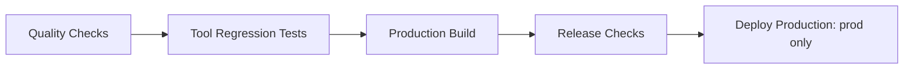

# Production Pipeline

[Documentation Home](../README.md)

Workflow: [.github/workflows/prod.yml](../.github/workflows/prod.yml).
The Git root is this application's directory: files in the parent workspace's
`.github/` are not discovered by GitHub for this repository.

## Branch and Release Policy

`prod` is the only automatically deployed branch. Develop on `feature_dev`
or another feature branch, then open a pull request into `prod`.
Pull requests run all validation but never deploy or receive Firebase credentials.
After merge, the push to `prod` reruns validation and deploys only on success.
Manual workflow runs also validate; they deploy only when the selected ref is
`prod`.

No workflow is triggered merely by pushing an unrelated feature branch unless
it has a pull request into `prod`. There is no staging or automatic PR preview
deployment. Existing `main` is not deployed by this workflow and is not deleted.

## Stages



| Stage / GitHub check | Required work |
| --- | --- |
| Quality Checks | Locked Node install, ESLint, ES-module syntax, documentation links/examples/commands, Python syntax |
| Tool Regression Tests | Python dependencies and verified OCR data, 12 Python conversion tests (PDF editability and Word-to-PDF with Office engines disabled), Chromium, all 33 browser regression tests including scans, image-preview equality, and document contrast/sizing in both themes |
| Production Build | Vite production build; upload immutable `dist/` artifact for the run's SHA |
| Release Checks | Download that artifact and run two browser smoke tests against Vite preview, not the dev server |
| Deploy Production | Require all prior jobs, prod ref, environment controls, latest revision, valid credentials, then deploy the same artifact to Firebase's live channel |

Runners use Ubuntu 24.04, Node 24, and Python 3.12. The workflow pins action
implementations to verified commit SHAs and Firebase CLI to 15.33.0. npm uses
`npm ci` and the lockfile; Python uses pinned direct requirements and
`pip check`. Python transitive dependencies are not fully locked.

There is no `continue-on-error` on validation or deploy. Focused
`test.only` is rejected under CI. Failed tests retain screenshots/traces;
reports and build artifacts are retained for 14 days. A green browser suite is
not a vulnerability, full accessibility, or conversion-layout audit.

The smoke suite checks multi-sheet spreadsheet upload, selected totals,
chart controls, reset, local workbook takeaways, routes, theme persistence, logos,
and demo assets. It runs locally against the **built** site. It is not a
post-deployment uptime test or a test of a separately hosted backend.

## Required GitHub Configuration

Create an environment named **prod** under repository Settings > Environments.
Restrict its deployment branches to `prod`. If your repository/account
supports it, configure required reviewers and prevent self-approval for an
additional release approval. Without reviewers, deployment is automatic after
checks. Environment features depend on GitHub plan/repository visibility; see
[GitHub deployment controls](https://docs.github.com/en/actions/how-tos/deploy/configure-and-manage-deployments/control-deployments).

Add the following values:

| Setting | Scope | Value |
| --- | --- | --- |
| `FIREBASE_SERVICE_ACCOUNT` | **prod environment secret** | Complete JSON key for a dedicated deploy service account |
| `FIREBASE_PROJECT_ID` | prod environment or repository variable | `easymadeinsights`, or your actual Firebase project ID |
| `VITE_API_BASE_URL` | **repository variable**, optional | HTTPS API origin for document conversion, without `/api` |

The build job deliberately has no production credentials or environment gate.
It cannot read prod-environment-only variables, so put the public frontend API
origin in repository variables. Leave it empty for same-origin routing, or for
a frontend-only release where conversion is unavailable.

No OpenAI key is used by CI. Do not put server credentials in `VITE_`
variables, committed files, or build artifacts. GitHub's built-in token is
read-only; no personal access token or deprecated Firebase CLI token is needed.

### Firebase Deployment Account

In Google Cloud IAM for the same Firebase project, create a dedicated service
account for Hosting deployment. Grant Firebase Hosting Admin
(`roles/firebasehosting.admin`) and API Keys Viewer
(`roles/serviceusage.apiKeysViewer`) for the CLI's project/API-key lookup.
Use product-specific roles rather than Owner/Editor. If an organization imposes
additional permissions or key restrictions, resolve that with its administrator
rather than broadening the workflow blindly.

Create a JSON key for that account and add its complete content to the
`FIREBASE_SERVICE_ACCOUNT` environment secret. Never commit the downloaded
key or paste it into logs/chat. The workflow verifies the key's project ID
matches the configured deployment project without printing the key.

See [Firebase Hosting roles](https://firebase.google.com/docs/projects/iam/roles-predefined-product#firebase-hosting-roles)
and the [Firebase CLI integration implementation](https://github.com/firebase/firebase-tools/blob/master/src/init/features/hosting/github.ts)
for permission context. The generic CLI setup can grant broader roles for
preview/auth/functions use; this workflow only deploys static Hosting.

The [official Hosting action](https://github.com/FirebaseExtended/action-hosting-deploy)
supports service-account JSON credentials. This implementation uses that
mechanism, not workload identity federation. Rotate/revoke keys appropriately;
organizations that forbid keys need an adapted OIDC/WIF authentication design.
Do not run `firebase init hosting:github` on top of this workflow without
reviewing its generated files: a second live-deploy workflow could bypass these
quality gates or deploy from another branch.

## Protecting prod

Configure a branch ruleset/protection rule for `prod`:

1. Require pull requests, review approval where practical, and resolved comments.
2. Require the **Quality Checks**, **Tool Regression Tests**, **Production Build**,
   and **Release Checks** status checks from this workflow.
3. Require the branch to be up to date before merging.
4. Block force pushes/deletion and restrict bypass permissions.

Do **not** require Deploy Production as a PR status check: that job intentionally
does not run on PRs. GitHub only offers status checks after they have appeared
in a workflow run. Run the first PR validation before selecting their exact
names in repository settings.

Avoid enabling a merge queue until `merge_group` support is added to the
workflow. No remote ruleset, secret, or reviewer setting is configured by simply
committing YAML. Review changes to the workflow itself as carefully as app code.

## First Release

A local `prod` branch has been created from the existing `feature_dev`
commit without switching branches or committing the worktree. It does not yet
contain uncommitted pipeline/app changes.

1. Configure Firebase credentials and the prod environment before merging a
   release. Confirm the Firebase Hosting project/site already exists.
2. Review and commit the pipeline **and all runtime/test/documentation files it
   needs** on `feature_dev`. Do not commit `.env`, keys, generated output,
   or virtual environments.
3. Publish the baseline production branch and committed feature branch:

```powershell
git push origin prod
git push origin feature_dev
```

4. Open a GitHub pull request from `feature_dev` to `prod`. The initial
   baseline prod push may have no workflow yet; the PR supplies it.
5. Inspect passing checks and artifacts, then configure required status checks
   and merge protection. Merge the reviewed PR.
6. Watch the new prod push complete validation and Deploy Production. If required
   reviewers were configured, approve its environment deployment.

Do not bypass failed checks by copying only the `dist/` folder or adding
another unconditional deploy workflow. If `prod` already exists remotely,
fetch/reconcile it instead of force-pushing the locally created baseline.

GitHub only exposes manual dispatch when the workflow also exists on the
repository's default branch. After adopting this model, you may make `prod`
the default branch; otherwise ensure the default branch has the workflow before
expecting an Actions Run Workflow button.

## Local Verification

From this Git root:

```powershell
npm.cmd ci
npm.cmd run lint
npm.cmd run check:syntax
npm.cmd run check:docs
.\.venv\Scripts\python.exe -m py_compile python\convert_tool.py
.\.venv\Scripts\python.exe python\setup_ocr.py
.\.venv\Scripts\python.exe -m unittest discover -s python/tests -v
npm.cmd run test:tools
npm.cmd run build
npm.cmd run test:smoke
```

Install Python/Chromium first as described in [Development](DEVELOPMENT.md).
Local checks do not deploy. Tool tests use ports 5190/8791; artifact smoke tests
use 5192 with no API. Separate report/output directories allow the suites to
coexist locally. CI does not reuse existing servers or retry failures.

## Failure, Concurrency, and Rollback

A failed job prevents all later release jobs. Report artifacts may help diagnose
the failure; installing Python packages alone does not prove engine readiness.
The build still warns about large bundles; this warning is not currently a
failure threshold. There is no enforced dependency vulnerability scanner yet.

New PR runs cancel older PR runs. Production runs/deployments are serialized
rather than interrupting an in-flight release. Immediately before deploying,
the workflow rejects a revision if `prod` has moved forward. GitHub does not
guarantee FIFO concurrency ordering, so superseded runs may fail or be replaced
while the latest commit completes. A rerun of an old commit is not a rollback.

For rollback, create a reviewed revert on `prod` through the same PR/check
process, or use an appropriate prior Hosting release as an explicitly recorded
emergency action. Backend rollback is independent. A successful deploy job means
the Hosting action completed, not that all external services are healthy.

## Deployment Scope

The final job deploys **Firebase Hosting's frontend only**. It does not publish
`server.mjs`, Python, LibreOffice, Firebase Functions, or a Cloud Run service.
Real converters/OCR are tested in ephemeral CI, not installed in production.
Provision OCR data on the actual conversion backend. Set up its routing/security before
advertising production document conversion; see [Deployment](DEPLOYMENT.md).
